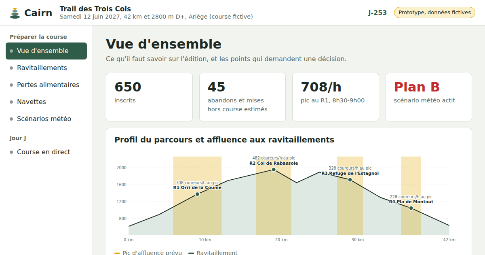

# Cairn

Prototype d'outil d'aide à la décision pour les organisateurs de trail en montagne.

**Démo en ligne : https://paullefrais.github.io/cairn/**

## Le problème

Un organisateur de trail prend chaque année les mêmes décisions, souvent à l'expérience : combien de nourriture et de bénévoles à chaque ravitaillement, combien de navettes et à quelle heure, quel plan de repli si la météo tourne. Cairn explore comment les données des éditions passées, la météo et les inscriptions peuvent rendre ces décisions plus sûres et réduire le gaspillage.

## Ce que montre le prototype

- **Vue d'ensemble** : chiffres clés, profil du parcours, affluence prévue et points à décider.
- **Ravitaillements** : passages prévus par demi-heure, quantités d'eau et de solide, nombre de bénévoles.
- **Pertes alimentaires** : comparaison avec les pertes de l'édition précédente et commande recommandée selon la marge de sécurité.
- **Navettes** : bus pour le départ, places nécessaires heure par heure, rapatriement des abandons.
- **Scénarios météo** : plans A, B et C déclenchés selon les prévisions sur les heures en altitude.
- **Course en direct** : simulation de la position du peloton, des barrières horaires et du journal de course.

## À propos des données

Toutes les données sont **fictives** : le Trail des Trois Cols n'existe pas. Les 650 coureurs sont simulés à partir d'une distribution de temps réaliste. Les règles de calcul (consommation par coureur, ratio de bénévoles, seuils météo) sont des hypothèses à valider avec des organisateurs.

## Structure

Un seul fichier `index.html`, sans serveur ni dépendance à installer. Les données fictives sont regroupées en haut du script (`RACE`, `RAVITOS`, `PROFILE`, `WEATHER`) et peuvent être remplacées par celles d'une vraie course.

## Contact

Projet porté par Paul Lefrais, élève ingénieur à ISAE-Supaero.
Vous organisez une course et voulez donner votre avis ? Écrivez-moi sur [LinkedIn](https://www.linkedin.com/in/paullefrais).
